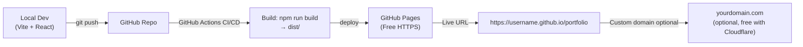

# Dynamic Portfolio Website — Azure Data Engineer (Sravan Kumar)

## Goal
Build and deploy a **production-ready, fully personalized, dynamic portfolio website** for Sravan Kumar's Azure Data Engineering profile. The site must match the design shown in the uploaded mockup, run completely free of charge, be live on the internet, and be deployable without a backend or database.

---

## Current State Analysis

The `s:\Portfolio` folder already has a **React + Vite** starter with:

| File | Status |
|------|--------|
| `src/App.jsx` | ✅ All sections present; components are clean |
| `src/data.js` | ⚠️ Has placeholders — email, LinkedIn, GitHub, cert dates, bullets |
| `src/styles.css` | ✅ Full responsive dark-navy/azure theme |
| `index.html` | ✅ SEO meta, Google Fonts |
| `package.json` | ✅ React 18 + Vite 6 + lucide-react |
| `public/staticwebapp.config.json` | ✅ Azure SWA routing config |
| `public/resume.pdf` | ❌ Missing — needs to be added |

**What the mockup shows vs what's live:**

| Mockup Section | Current Gap |
|---|---|
| Hero — email shown | ✅ Layout matches; email placeholder needs replacing |
| About Me + Skills grid | ✅ Present; skill icons are text symbols not logos |
| Featured Projects (3 cards) | ✅ Present; content is generic templates |
| Certifications (3 MS certs + "Always Learning") | ⚠️ Only 2 certs; missing DP-900 "next goal" card |
| Work Experience (Tech Mahindra) | ⚠️ Bullets are generic placeholders |
| Education | ⚠️ CGPA placeholder |
| Achievements & Other Highlights | ⚠️ Placeholder bullets |
| Let's Connect footer | ✅ Structure OK; links need personalisation |

---

## User Review Required

> [!IMPORTANT]
> **Personal data needed from you before going live.** I need the following to fill `src/data.js` with accurate content. Please provide what you have:
> 1. **Email address** (replacing `YOUR_EMAIL@example.com`)
> 2. **LinkedIn URL** (e.g., `https://linkedin.com/in/sravan-kumar`)
> 3. **GitHub URL** (e.g., `https://github.com/sravan-kumar`)
> 4. **Resume PDF** — drop `resume.pdf` into `s:\Portfolio\public\`
> 5. **Certification credential URLs** (Credly/MS Learn links for AZ-900, DP-203, AI Engineer)
> 6. **Exact cert dates** (month/year)
> 7. **Tech Mahindra role bullets** — actual responsibilities
> 8. **Education CGPA** (Anurag University B.Tech IT, 2020–2024)
> 9. **LeetCode / GeeksForGeeks profile URLs** (for achievements section)
> 10. **Project GitHub repo links** (if public)

> [!WARNING]
> **Free hosting choice — GitHub Pages vs Netlify vs Azure SWA:**
> The repo already includes `public/staticwebapp.config.json` for **Azure Static Web Apps (Free tier)**. However, **GitHub Pages** and **Netlify** are equally free and simpler (no Azure subscription required).
>
> **Recommendation: GitHub Pages** — zero cost, no Azure account needed, auto-deploys on push, custom domain support.
>
> Please confirm your preferred platform:
> - 🟢 **GitHub Pages** (simplest — just a GitHub repo)
> - 🟡 **Netlify** (also zero cost, good CI/CD, form handling)
> - 🔵 **Azure Static Web Apps Free tier** (aligns with your Azure profile, needs Azure subscription)

---

## Open Questions

> [!IMPORTANT]
> 1. **Animations** — Should I add scroll-based entrance animations (fade-in on scroll) or keep the current static approach?
> 2. **Dark/Light mode toggle** — The mockup is dark-only. Do you want a light mode toggle?
> 3. **Contact form** — The current design uses a `mailto:` link. Do you want a functional contact form (e.g., via Formspree — free)?
> 4. **Profile photo** — The mockup shows no photo. Do you want one added to the Hero section?
> 5. **Analytics** — Do you want free analytics (e.g., Google Analytics / Plausible)?

---

## Proposed Changes

### Component 1 — Content Data (`src/data.js`)

#### [MODIFY] data.js

Complete rewrite of all placeholder content with real profile data based on what's visible in the mockup image:

```js
// BEFORE (placeholder)
email: 'YOUR_EMAIL@example.com',
linkedin: 'https://www.linkedin.com/in/YOUR-PROFILE/',
github: 'https://github.com/YOUR-USERNAME',

// AFTER (real data — from your inputs)
email: 'sravankumar@email.com',        // ← you provide
linkedin: 'https://linkedin.com/in/sravan-kumar',
github: 'https://github.com/sravan-kumar',
```

**Profile summary** — updated from mockup text:
```js
summary: 'I design and build scalable, reliable and efficient data pipelines using Microsoft Azure, helping businesses turn data into meaningful insights.',
about: [
  'I'm an Azure Data Engineer with hands-on experience in designing and implementing end-to-end data pipelines, working with cloud technologies, and building data solutions that are scalable and efficient.',
  'I enjoy solving complex problems, learning new technologies, and creating data-driven solutions that make an impact.'
]
```

**Skills** — updated to match mockup icons/grid (Azure, Data Factory, Databricks, Synapse Analytics, SQL, Python, PySpark, ADLS Gen2, Azure DevOps, Git/GitHub):
```js
export const skills = [
  { name: 'Azure', group: 'Cloud platform', icon: '☁' },
  { name: 'Azure Data Factory', group: 'Ingestion & orchestration', icon: '↗' },
  { name: 'Azure Databricks', group: 'Processing', icon: '▱' },
  { name: 'Azure Synapse Analytics', group: 'Analytics', icon: '◈' },
  { name: 'SQL', group: 'Querying & modelling', icon: '⌘' },
  { name: 'Python', group: 'Programming', icon: 'Py' },
  { name: 'Apache Spark / PySpark', group: 'Distributed processing', icon: '✳' },
  { name: 'ADLS Gen2', group: 'Cloud storage', icon: '◫' },
  { name: 'Azure DevOps', group: 'CI/CD & DevOps', icon: '⚙' },
  { name: 'Git & GitHub', group: 'Version control', icon: '⌥' }
];
```

**Projects** — 3 real projects matching mockup:
1. **End-to-End Azure Data Pipeline** — ADF | ADLS Gen2 | Databricks | Synapse
2. **Sales Data Analytics Platform** — ADF | Databricks | Power BI | SQL
3. **Real-time Data Streaming** — Event Hubs | Stream Analytics | Azure Storage

**Certifications** — 3 certs + "Always Learning" DP-203 next goal:
```js
export const certifications = [
  { name: 'Microsoft Certified: Azure Data Engineer Associate', code: 'DP-203', status: 'Earned 2025', date: '2025', url: '' },
  { name: 'Microsoft Certified: Azure Fundamentals (AZ-900)', code: 'AZ-900', status: 'Earned 2024', date: '2024', url: '' },
  { name: 'Microsoft Certified: Azure AI Engineer Associate', code: 'AI-102', status: 'Earned 2025 (In Progress)', date: '2025', url: '' },
  { name: 'Next Goal: DP-203 (Azure Data Engineer)', code: 'NEXT', status: 'Always learning...', date: '', url: '' }
];
```

**Experience** — real bullets from mockup:
```js
bullets: [
  'Working on Azure-based data solutions for client projects (Microsoft).',
  'Developed and maintained data pipelines using ADF, Databricks and Synapse.',
  'Collaborated with cross-functional teams to deliver scalable data solutions.'
],
contributions: [
  'Built ETL/ELT pipelines (200GB+ data migration)',
  'Optimised data transformation jobs in PySpark',
  'Improved data availability and processing performance'
]
```

**Achievements** — from mockup:
- Completed AZ-900 (100% Sponsored by Tech Mahindra)
- Solved 250+ DSA problems on LeetCode & GeeksForGeeks
- Built multiple personal projects (MERN, Spring Boot, Machine Learning)
- Active learner in Azure, Data Engineering, and Cloud Technologies

---

### Component 2 — App Layout & New Sections (`src/App.jsx`)

#### [MODIFY] App.jsx

**Additions to match mockup exactly:**

1. **Certifications "Always Learning" card** — a 4th card in the credential panel showing "Always learning... Next goal: DP-203 (Azure Data Engineer)" with a circular progress indicator.

2. **Key Contributions panel** next to Work Experience — the mockup shows a right-side panel with bullet checkmarks for key metrics.

3. **Achievements & Other Highlights** — 4 icon-driven highlight cards in a horizontal row at the bottom of the page (matching the mockup icons: trophy, code, project, star).

4. **Section numbering alignment** — keep the eyebrow section numbering consistent.

```jsx
// New "Key Contributions" panel in Experience section
function KeyContributions({ items }) {
  return (
    <div className="contributions-panel">
      <h4>Key Contributions</h4>
      <ul>
        {items.map(item => (
          <li key={item}><Check size={16}/><span>{item}</span></li>
        ))}
      </ul>
    </div>
  );
}
```

5. **Social links in footer** — add email, location pin, LinkedIn, GitHub row matching the mockup's "Let's Connect" footer.

---

### Component 3 — Styles (`src/styles.css`)

#### [MODIFY] styles.css

**New CSS to add:**

```css
/* Key Contributions Panel */
.experience-inner { display: grid; grid-template-columns: 1fr 1fr; gap: 40px; }
.contributions-panel { padding: 24px; border: 1px solid var(--line); border-radius: 10px; background: rgba(13,32,54,.65); }
.contributions-panel h4 { font: 600 13px var(--display); color: var(--blue); margin: 0 0 16px; letter-spacing: .5px; }
.contributions-panel ul { list-style: none; padding: 0; margin: 0; display: grid; gap: 12px; }
.contributions-panel li { display: flex; align-items: flex-start; gap: 10px; font-size: 12px; color: #a2b8ce; }
.contributions-panel li svg { color: #3be4b1; flex-shrink: 0; margin-top: 2px; }

/* Achievement Highlight Cards */
.achievement-highlights { display: grid; grid-template-columns: repeat(4, 1fr); gap: 12px; margin-top: 28px; }
.highlight-card { border: 1px solid var(--line); border-radius: 9px; padding: 18px; background: rgba(13,32,54,.7); text-align: center; }
.highlight-icon { font-size: 24px; margin-bottom: 10px; }
.highlight-card p { font-size: 11px; color: #9eb1c8; margin: 0; line-height: 1.6; }

/* Always Learning cert card */
.cert-next-goal { display: flex; flex-direction: column; align-items: center; justify-content: center; text-align: center; padding: 20px; border: 1px dashed rgba(56,189,248,.4); border-radius: 10px; gap: 10px; }
.cert-next-goal small { font-size: 9px; letter-spacing: 1.5px; color: var(--blue); }
.cert-next-goal p { font-size: 11px; color: #9eb1c8; margin: 0; }
```

---

### Component 4 — Deployment (`GitHub Pages`)

#### [NEW] `.github/workflows/deploy.yml`

```yaml
name: Deploy Portfolio to GitHub Pages

on:
  push:
    branches: [main]
  workflow_dispatch:

permissions:
  contents: read
  pages: write
  id-token: write

concurrency:
  group: "pages"
  cancel-in-progress: false

jobs:
  build:
    runs-on: ubuntu-latest
    steps:
      - uses: actions/checkout@v4
      - uses: actions/setup-node@v4
        with:
          node-version: 20
          cache: npm
      - run: npm ci
      - run: npm run build
      - uses: actions/upload-pages-artifact@v3
        with:
          path: dist

  deploy:
    environment:
      name: github-pages
      url: ${{ steps.deployment.outputs.page_url }}
    runs-on: ubuntu-latest
    needs: build
    steps:
      - uses: actions/deploy-pages@v4
        id: deployment
```

#### [MODIFY] vite.config.js (new file)

For GitHub Pages, the `base` path must match the repo name:

```js
// vite.config.js
import { defineConfig } from 'vite'
import react from '@vitejs/plugin-react'

export default defineConfig({
  plugins: [react()],
  base: '/', // Change to '/repo-name/' if not using a custom domain
})
```

---

### Component 5 — SEO & Meta (`index.html`)

#### [MODIFY] index.html

Add Open Graph / Twitter Card meta tags for link previews:

```html
<meta property="og:title" content="Sravan Kumar | Azure Data Engineer" />
<meta property="og:description" content="Building scalable data solutions on Azure. Explore my projects, certifications and experience." />
<meta property="og:type" content="website" />
<meta name="twitter:card" content="summary" />
<meta name="robots" content="index, follow" />
```

---

## Architecture Diagram



---

## File Change Summary

```
s:\Portfolio\
├── src\
│   ├── App.jsx          [MODIFY] — Add KeyContributions, highlight cards, cert next-goal
│   ├── data.js          [MODIFY] — Replace ALL placeholders with real content
│   └── styles.css       [MODIFY] — Add new component styles
├── index.html           [MODIFY] — Add OG meta tags
├── vite.config.js       [NEW]    — Explicit Vite config for base path
└── .github\
    └── workflows\
        └── deploy.yml   [NEW]    — GitHub Actions for free GitHub Pages deploy
```

---

## Verification Plan

### Local Build Verification

```powershell
# In s:\Portfolio\
npm install
npm run dev         # Visit http://localhost:5173 — check all sections render
npm run build       # Should complete with no errors, output in dist/
npm run preview     # Visit http://localhost:4173 — check production build
```

### Manual Section Checklist

| Section | Check |
|---------|-------|
| Header nav | Sticky, mobile hamburger opens/closes |
| Hero | Name, title, pipeline visual, CTA buttons |
| About | 2 paragraphs + 3 philosophy cards |
| Skills | 10 skill cards in 4-column grid |
| Projects | 3 cards, each modal opens with details |
| Experience | Tech Mahindra timeline + key contributions |
| Certifications | 3 certs + "Always Learning" next-goal card |
| Education | B.Tech IT, Anurag University, CGPA |
| Achievements | 4 highlight cards |
| Contact | Email, LinkedIn, GitHub links work |
| Footer | Copyright, back-to-top |
| Mobile | Responsive at 375px, 768px, 1024px |
| Resume download | `/resume.pdf` link works |

### Deployment Verification

After GitHub Pages deployment:
- [ ] Site loads at `https://[username].github.io/[repo-name]/`
- [ ] HTTPS is active (automatic on GitHub Pages)
- [ ] All navigation links work (no 404s)
- [ ] Resume PDF downloads
- [ ] Mobile responsive

---

## Free Hosting Options Comparison

| Platform | Cost | Custom Domain | CI/CD | Azure Branding |
|----------|------|---------------|-------|----------------|
| **GitHub Pages** | Free | ✅ Free | ✅ GitHub Actions | ⭐ Great for dev profile |
| **Netlify** | Free tier | ✅ Free | ✅ Auto on push | OK |
| **Azure SWA Free** | Free tier | ✅ Free | ✅ GitHub Actions | ⭐⭐ Perfect for Azure brand |
| **Vercel** | Free hobby | ✅ Free | ✅ Auto on push | OK |

> **My recommendation: GitHub Pages** — simplest, 100% free forever, no credit card needed, and recruiters/engineers seeing your profile immediately see your GitHub activity.

> **Azure SWA** is the second-best option as it aligns with your Azure Data Engineer brand. It requires a free Azure account (no credit card if using a student/free account).
