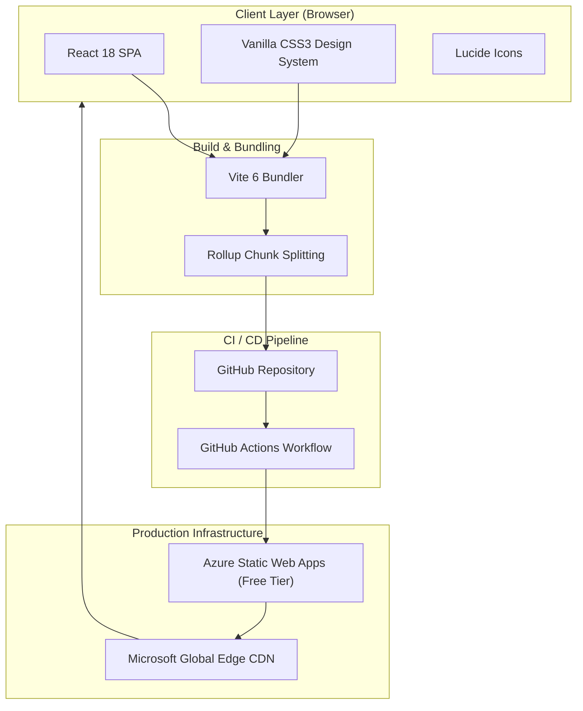
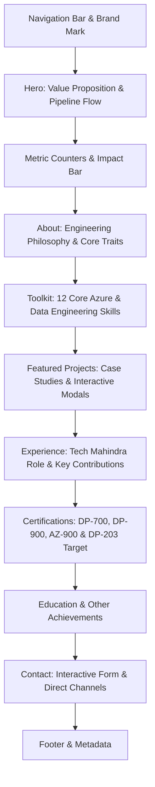
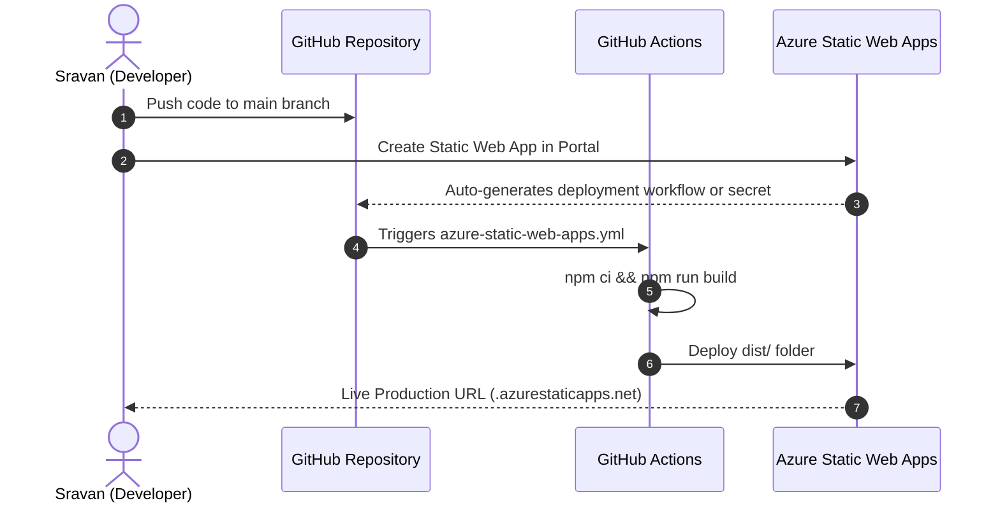

# 📘 Technical & Ideation Architecture Document
## Sravan Kumar — Azure Data Engineer Portfolio Platform

---

## 1. Executive Summary & Vision

### 1.1 Purpose
The primary objective of this portfolio platform is to position **Sulige Sravan** as an elite **Azure Data Engineer** with practical, production-grade cloud capabilities. Rather than a static, generic resume website, this platform serves as an interactive showcase illustrating:
- Enterprise ETL/ELT pipeline design principles.
- End-to-end Medallion Architecture (Bronze $\rightarrow$ Silver $\rightarrow$ Gold).
- Quantifiable engineering impact (e.g., $200\text{ GB}+$ migrations, $25\%$ processing latency reduction, $99\%+$ pipeline uptime).
- Verifiable Microsoft credentials and academic pedigree.

### 1.2 Core Pillars
1. **Cloud & Data-Themed Visual Identity:** Deep navy, neon azure accents, and animated data-flow schematics mimicking Azure Synapse and Data Factory interfaces.
2. **Dynamic & Interactive Architecture:** Reactive modals for project deep-dives, typewriter animations, animated counter metrics, and interactive contact pipelines.
3. **Zero-Cost, High-Performance Hosting:** Serverless static hosting on **Azure Static Web Apps (Free Tier)** coupled with automated GitHub Actions CI/CD.

---

## 2. Technical Stack & Architecture

### 2.1 System Architecture



### 2.2 Technology Breakdown

| Component | Technology | Rationale |
| :--- | :--- | :--- |
| **Framework** | React 18 (Vite 6 SPA) | Sub-second load times, modular component architecture, low overhead. |
| **Styling** | Modular Modern CSS | Custom properties (CSS variables), glassmorphism (`backdrop-filter`), zero CSS-framework bloat. |
| **Icons** | `lucide-react` | Crisp, scalable, tree-shakeable SVG icons tailored for tech stacks. |
| **Build Tool** | Vite 6 + Rollup | Instant HMR during development, optimized chunking (`vendor`, `icons`, `app`). |
| **Hosting** | Azure Static Web Apps | Native Azure branding, free SSL, global CDN, and automated CI/CD integration. |
| **Contact Ingestion**| Formspree API + Mailto Fallback | Free serverless form handling without requiring backend infrastructure. |

---

## 3. Ideation & UX Design System

### 3.1 Color Palette & Design Tokens

```
--bg:        #060f1e  (Deep Azure Void - Background)
--bg2:       #091526  (Dark Navy - Secondary Sections)
--panel:     #0d2038  (Frosted Azure Card Panels)
--blue:      #38bdf8  (Azure Sky Cyan - Accents & Primary CTAs)
--blue2:     #1688ff  (Electric Azure - Gradients & Energy)
--green:     #3be4b1  (Pipeline Health & Verification Badges)
--amber:     #f59e0b  (In-Progress & Cert Milestones)
```

### 3.2 Visual Metaphors & Animations
- **The Pipeline Flow Visual:** Located in the Hero section, this interactive orbital schematic visually maps the 4 critical data engineering phases: `INGEST` $\rightarrow$ `TRANSFORM` $\rightarrow$ `STORE` $\rightarrow$ `ANALYZE`.
- **Typewriter Role Rotator:** Cycles between `"Azure Data Engineer"`, `"PySpark Developer"`, `"Cloud Data Architect"`, and `"ETL/ELT Specialist"`.
- **Animated Metric Counters:** Smooth cubic-bezier number increments (`2+`, `200GB+`, `4+`, `99%+`) triggered upon scroll viewport intersection.
- **Micro-Interactions:** Subtle card elevations, glow pulses on active nodes, and hover-triggered gradient reveals.

---

## 4. Information Architecture & Section Breakdown



### 4.1 Section Specifications

1. **Hero Section (`#home`):**
   - High-impact headline: *"Building Scalable Data Solutions on Azure"*.
   - Location, experience, and direct download CTA for `public/resume.pdf`.
   - Real-time animated pipeline visualization with Delta Lake, PySpark, and SQL tags.

2. **Impact & Stats Bar:**
   - 4 key metrics: Experience, Data Volume Migrated, Certified Credentials, and Pipeline Success Rate.

3. **About Me (`#about`):**
   - Focuses on enterprise reliability, observability, and data validation as core principles.
   - Core behavioral traits: *Problem Solver*, *Quick Learner*, *Team Player*.

4. **Technical Toolkit (`#skills`):**
   - 12 tailored skills categorised into Cloud Platform, Compute, Storage, Analytics, and Governance:
     - Azure, ADF, Azure Databricks, Azure Synapse, Azure Fabric, SQL, Python, PySpark, Delta Lake, ADLS Gen2, Unity Catalog, Git/GitHub.

5. **Selected Projects (`#projects`):**
   - **Project 01:** *E-Commerce Analytics Pipeline with Databricks & Medallion Architecture* (100 GB, Delta Lake, Unity Catalog).
   - **Project 02:** *End-to-End Azure Data Pipeline — On-Prem to ADLS Gen2* (200 GB migration, ADF Mapping Data Flows).
   - **Project 03:** *Real-time Data Streaming Platform* (Event Hubs, Stream Analytics).
   - *Feature:* Interactive case-study modal providing implementation breakdowns and KPI metrics.

6. **Experience (`#experience`):**
   - Role at **Tech Mahindra** with dedicated split-view:
     - Enterprise B2B responsibilities.
     - Highlighted **Key Contributions** panel (migration metrics, PySpark tuning).

7. **Certifications & Goals (`#certifications`):**
   - Official credentials: **DP-700**, **DP-900**, **AZ-900**, **GH-300**.
   - Direct verification link to Microsoft Learn profile.
   - **"Always Learning" Goal Card:** Dedicated progress bar for DP-203.

8. **Education & Achievements (`#education`):**
   - B.Tech IT from Anurag University ($8.45\text{ CGPA}$).
   - Achievement cards: $250+\text{ DSA}$ problems, full tech stack applications.

9. **Contact & Connect (`#contact`):**
   - Client-side validated form (`Name`, `Email`, `Subject`, `Message`).
   - Dual submission path: Formspree endpoint with seamless mailto fallback.

---

## 5. Performance, SEO & Accessibility (a11y)

### 5.1 Performance Optimization
- **Code Splitting:** Configured Rollup `manualChunks` in [`vite.config.js`](file:///s:/Portfolio/vite.config.js) to isolate vendor packages (`react`, `react-dom`) and UI symbols (`lucide-react`).
- **Asset Size:** Production bundle produces $\approx 31\text{ KB}$ CSS and $\approx 47\text{ KB}$ gzipped JS, ensuring instant Time-To-Interactive (TTI).
- **Reduced Motion Support:** Respects user OS preference (`@media (prefers-reduced-motion: reduce)`).

### 5.2 SEO & Social Sharing
- High-fidelity Open Graph (`og:*`) tags and Twitter Card tags in [`index.html`](file:///s:/Portfolio/index.html).
- Complete search engine indexing metadata: keyword tags targeted for Azure Data Engineer recruiters.
- Semantic HTML tags (`<header>`, `<main>`, `<section>`, `<article>`, `<footer>`).

---

## 6. Deployment & Maintenance Guide (Azure Static Web Apps)

### 6.1 Prerequisites
- A GitHub repository containing the codebase.
- An Azure Account (Free Tier).

### 6.2 Deployment Walkthrough



1. **Step 1 — Push to GitHub:**
   ```powershell
   cd s:\Portfolio
   git init
   git add .
   git commit -m "feat: complete Azure Data Engineer dynamic portfolio"
   git branch -M main
   git remote add origin https://github.com/ssravan18/portfolio.git
   git push -u origin main
   ```

2. **Step 2 — Provision Azure Static Web App:**
   - Navigate to the [Azure Portal](https://portal.azure.com/).
   - Click **Create a resource** $\rightarrow$ Search for **Static Web App**.
   - Plan type: **Free** (includes free SSL, 100 GB bandwidth/month, custom domains).
   - Deployment Source: Select **GitHub** and authorize access to `ssravan18/portfolio`.
   - Build Presets:
     - **App location:** `/`
     - **Api location:** *(leave empty)*
     - **Output location:** `dist`

3. **Step 3 — Automatic Workflow Execution:**
   - Azure or your predefined [`.github/workflows/azure-static-web-apps.yml`](file:///s:/Portfolio/.github/workflows/azure-static-web-apps.yml) will build and push the production assets.
   - Within 2 minutes, your website is globally live with HTTPS.

---

## 7. Future Roadmap & Enhancements

- [ ] **Live Interactive Data Pipeline Simulator:** Add an interactive canvas or React Flow widget where visitors can trigger simulated batch or streaming data flows.
- [ ] **Blog & Technical Articles Section:** Integrate Markdown-based articles detailing PySpark performance tuning and Delta Lake optimization tips.
- [ ] **Custom Domain Binding:** Bind a personalized domain name (e.g., `sravansulige.dev` or `sravan.tech`) via Azure's free custom domain SSL service.
